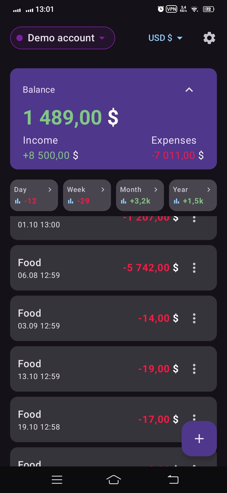
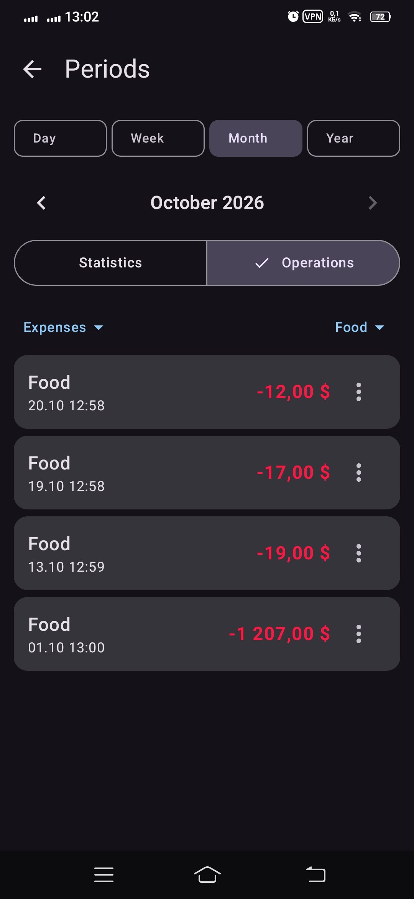

# FinTrack — your finances, your device, your rules

**FinTrack** is a fully offline personal finance tracker for Android. No cloud,
no accounts, no ads, no telemetry — your money history lives only on your phone,
protected by military-grade encryption.

🇷🇺 **[Русская версия](docs/README.ru.md)** · 🛠 **[Developer guide](docs/DEVELOPMENT.md)**

---

## Screenshots

  
  

## Why FinTrack

### 🔐 Security you can actually verify
- **AES-256 encrypted database** (Room + SQLCipher). The encryption key is
  derived from your **pattern lock** via PBKDF2 (SHA-256, 120,000 iterations) —
  the pattern *is* the key. Without it the database file is physically
  unreadable, even to a root shell or a disk image.
- **Auto-wipe**: 3 wrong patterns and the key, salt and database file are
  destroyed. An attacker gets nothing, ever.
- **No INTERNET permission at all.** The app cannot send your data anywhere —
  this is enforced by the Android manifest, not by a privacy policy.
- System backup is disabled: your finances never leave the device implicitly.

### 💶 Every currency you actually use
RUB, USD, EUR, CNY, TRY, EGP, AED, THB, PHP, VND, BYN — **11 currencies** with
native symbols. Switch instantly; history, totals and statistics are always
filtered per currency.

### 👥 Multiple accounts, real categories
- Keep separate books: personal, family, business — any number of **accounts**
  with color-coded identities.
- Built-in category catalog plus your own categories, each with a stable color
  for charts.

### 📊 Statistics that never slow down
- **Incremental totals**: every sum (day / week / month / year / all-time) is
  updated by a delta on each add/remove — no full-table scans, ever.
- **Periods screen**: bar charts by category for any period, plus an
  **Operations tab** with the full transaction list of that period, lazy-loaded
  20 records at a time via keyset pagination.
- A history of thousands of records opens as fast as one of ten.

### 💾 Your data is portable — and still private
- **Encrypted backup export/import**: the entire database into a single
  `.fintx` file, protected by **your own password** with PBKDF2 (310,000
  iterations) + AES-256-GCM. Restore on any device — the backup key is
  independent of the pattern lock.
  Import as **full replace** or **merge** (duplicates detected automatically).
- **CSV export for Excel**: account history with `;` separators, comma
  decimals and UTF-8 BOM — opens in Excel/LibreOffice/1C with a double click,
  localized headers, per-currency totals.

### ✨ Designed, not just built
- Jetpack Compose, **Material 3**, dark & light themes.
- Full **RU / EN localization** — every string in both languages.
- Collapsible balance card, compact period widgets, calendar & time pickers
  for backdating and planning entries, safe delete confirmations.

---

## Get the app

FinTrack is built and signed by **GitHub Actions** — see the
[Actions tab](https://github.com/pikselvorkeraund/fintrack/actions) of this
repository for the latest APK artifact. Building and signing options are
described in the [developer guide](docs/DEVELOPMENT.md).

## Documentation

- [docs/DEVELOPMENT.md](docs/DEVELOPMENT.md) — how the project is built, signed
  and released
- [DEV.md](DEV.md) — full architecture and code guide (for contributors)
- [AGENTS.md](AGENTS.md) — mandatory development rules

## License

This project is licensed under the GNU General Public License v3.0 - see the [LICENSE](LICENSE) file for details
